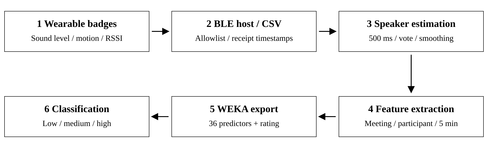
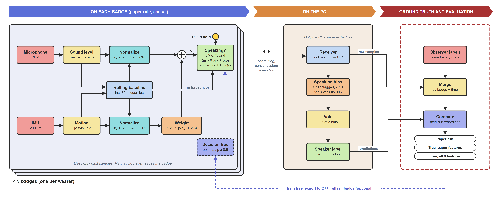

# SCI-Lab-BadgeSoftware

Software for the Smart Communities and IoT Lab's voice interaction badges at Kent
State University. Each participant wears a badge that reports sound level and
motion over Bluetooth Low Energy. The software estimates who is speaking and
summarizes how a meeting's conversation was shared.

The repository contains two implementations of the speaker detector:

- **Paper implementation:** the original pipeline described in the manuscript in
  [`paper/`](paper/README.md). Badges stream readings to a PC, and speaker
  labeling, feature extraction, and meeting classification all run afterward on
  the recorded data.
- **TinyML implementation:** a newer version in
  [`TinyML_Speaker/`](TinyML_Speaker/README.md). The badge itself scores each
  sample against a rolling baseline, the PC picks a speaker across badges, and an
  observer panel records ground truth for evaluation.

## How the two compare

| | Paper implementation | TinyML implementation |
| --- | --- | --- |
| Where speaker scoring runs | On the PC, after recording | On each badge, as samples arrive |
| Sampling | About 16 Hz nominal, host receipt timestamps | 200 Hz default (10, 50, 100, or 200 Hz), device clock mapped to UTC |
| Rolling baseline | 60 s; may use whole-recording quartiles at startup | 60 s, past samples only |
| Cross-badge decision | Top eligible score per 500 ms bin, centered 5-bin vote | Same rule, applied on the PC |
| Run post-processing | Drops runs under 2 s, merges gaps under 1.5 s, fills gaps under 0.5 s | Not applied |
| Ground truth | Manual active labels; unlabeled time is not verified | Observer panel with Speaking, Quiet, and explicit Unknown, saved every 0.2 s |
| Learned model | None on the badge; WEKA classifies whole meetings | Optional decision tree, exported to C++ and flashed to the badge |
| Badge identity | MAC address allowlist in the collector | Name flashed at upload with `-Name` |
| Hardware | Legacy badge sketches in `badge code/` | Arduino Nano 33 BLE Sense Rev2 |

Both use the same scoring rule from section 3.2 of the manuscript: sound and
motion are normalized against each badge's rolling quartiles, combined as
`s = n_s + 1.2 * clip(n_a, 0, 2.5)`, and a sample is eligible when `s >= 0.75` and
either the 1 s sound mean is above the 45th percentile or `s >= 3.5`.

## Paper implementation



The workflow runs in four stages. Each script opens a file dialog or prompts when
an input is not given on the command line.

1. **Collect.** `run_badge_system.bat` starts the BLE collector and the live graph
   viewer together (`-DataOnly` or `-GraphOnly` starts one). The collector,
   `Data Collection & Visualization/data_collection.py`, connects to the badges
   listed in its `BADGE_ADDRESS` table and writes one combined CSV.
   `find_badge_macs.py` scans for addresses to add to that table.
2. **Label speakers.** `Data Cleanup and Normalization/auto_label.py` applies the
   scoring rule, the cross-badge vote, and run post-processing to a recorded CSV.
   `badge_data_processor.py` labels periods by hand on a plot,
   `badge_stitcher.py` combines several recordings, and `label_comparison.py`
   compares manual and automatic labels.
3. **Extract features.** `Feature Extraction/feature_extraction.py` turns an
   auto-labeled CSV into meeting, participant, and 5 min window tables (turns,
   speaking ratios, Gini, entropy, and response latency, among others).
   `meeting_visualizer.py` plots them.
4. **Classify meetings.** `weka_exporter.py` asks for a low, medium, or high
   effectiveness label per meeting and writes a 36-predictor ARFF file for WEKA.
   `weka_visualizer.py` plots WEKA's text output.

```powershell
.\run_badge_system.bat
python "Data Cleanup and Normalization/auto_label.py"
python "Feature Extraction/feature_extraction.py" path\to\auto_labeled.csv --window-minutes 5
python "Feature Extraction/weka_exporter.py"
```

These scripts need Python 3 with bleak, pandas, NumPy, and matplotlib.

### What the paper reports

The manuscript evaluates 16 session records. Under a 10-fold, seed-1
reconstruction of the logged WEKA settings, Random Forest classifies 15 of 16
records correctly and a multilayer perceptron 13 of 16. The effectiveness labels
were assigned by the first author from the automatic-label outputs, so these
results show consistency with that judgment, not an independent outcome measure.
The speaker audit found that only 16.87% of badge-timestamp keys were annotated,
all as active, so speaker precision and accuracy could not be established. The
TinyML implementation's observer panel is meant to close that gap.

See [`paper/README.md`](paper/README.md) to build the manuscript and rerun the
reproducibility checks.

## TinyML implementation



The badge computes the paper's score causally and lights its LED when it thinks
its wearer is speaking. The PC receives every badge in parallel and applies the
same 500 ms selection and 5-bin vote. While a recording runs, an observer marks
each badge as Speaking, Quiet, or Unknown, and the viewer hides detections so they
cannot bias the labels. Finished runs can be reopened to compare detections with
the observer's labels.

The planned evaluation runs on held-out whole recordings and compares the paper
rule, a decision tree on the paper's features, and a tree that also uses gyro,
magnetometer, temperature, humidity, pressure, and proximity. This is
experimental: no detection accuracy or battery-life result has been established
yet.

From `TinyML_Speaker/` on Windows:

```powershell
.\run.bat setup
.\firmware.ps1 setup
.\firmware.ps1 upload -Port COM5 -Name badge01
.\run_viewer.bat
```

Use each board's real port and a unique name per badge. Details are in the
[TinyML README](TinyML_Speaker/README.md), the [viewer guide](TinyML_Speaker/VIEWER.md),
the [design notes](TinyML_Speaker/DESIGN.md), and the
[ground-truth protocol](TinyML_Speaker/GROUND_TRUTH.md).

## Other folders

- `Nano33SenseRev2_SerialRealtime/`: Rev2 firmware that streams every onboard
  sensor over USB serial or BLE, with a live dashboard. Useful for checking
  hardware.
- `presentations/`: the poster and slides.
- `badge_data/` and `currentdata/`: local recordings. These hold participant data
  and are ignored by git.

## License

GNU General Public License v3.0. See [LICENSE](LICENSE).
