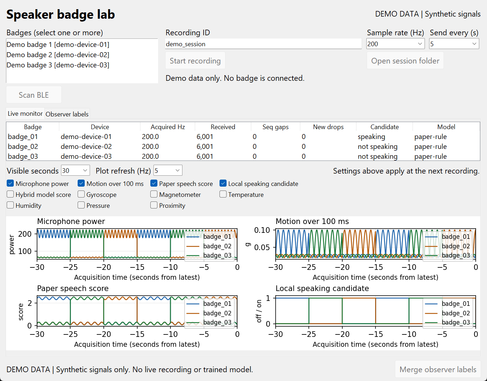
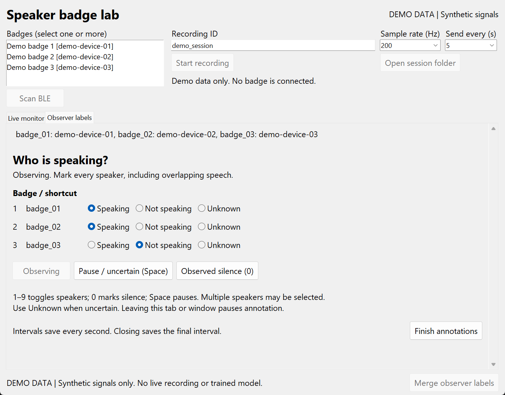

# Live speaker badge viewer

This native desktop viewer adapts the control and plotting approach from
`Nano33SenseRev2_SerialRealtime/realtime_viewer.py` to the new speaker firmware.
The old viewer is unchanged. This viewer uses BLE and the shared capture code;
it does not add a USB data stream to the speaker firmware.

## Run

From `TinyML_Speaker`:

```powershell
.\run.bat setup
.\run_viewer.bat
```

Matplotlib is the added plotting dependency. For a preview without a badge:

```powershell
.\run_viewer.bat --demo
```

The demo is explicitly labeled synthetic. It does not connect to BLE and cannot
validate sensor performance. The screenshots below use this mode.

## Record and monitor

1. Click **Scan BLE**, select the desired speaker badges, and verify their device
   identities against the physical wearers. Multiple badges may be selected.
2. Set an anonymous **Recording ID**, **Sample rate**, and **Send every** interval.
   These settings apply at recording start. Use the same ID for chunks of one
   session; use different IDs for independent sessions.
3. Click **Start recording**. Every received sample is saved into a new session
   folder under ignored `outputs/`. **Open session folder** locates the files.
4. Select sensor charts and adjust plot refresh or visible history as needed.
   Those controls affect drawing, not acquisition or CSV recording.
5. Click **Stop and save** to stop the badge, drain its buffer, and disconnect.
   Closing during a capture requests this same drain before the window exits.

The monitor shows measured rate from acquisition timestamps, received row counts,
sequence gaps, and new device drops relative to the first displayed row. The
plot history is bounded to 12,000 rows per badge and thinned to about 2,000 points
per trace. If the display queue falls behind, a footer message reports skipped
preview batches; CSV recording happens before plot delivery. Sensor traces from different
badges share their estimated UTC acquisition timeline, rather than aligning
unrelated device uptimes.

Speaking status is the local candidate of the latest received sample, which can
be several seconds old when sending in bulk. It is an estimate, not a reference
annotation. `paper-rule` means no trained hybrid model is active. The optional
model-score chart has no valid score while the firmware reports -1.



## Make independent observer labels

Once connected, switch to **Observer labels**. This hides the prediction table
and plots. Start observing explicitly, then mark speaking, not speaking, or
unknown for each wearer. Multiple speakers are supported. The keyboard shortcuts
are the same as the standalone panel: 1–9 toggle speakers, 0 marks observed
silence, and Space pauses.

Switching back to the monitor or leaving the window pauses annotation and keeps
that time unknown. Finishing annotations does not stop badge capture. Labels are
saved to `reference.csv` in the same session folder; a failed annotation save
stops the observer panel without closing the live viewer.

After stopping the recording, click **Merge observer labels** to create
`training.csv`. The merge preserves unobserved time as unknown and excludes
200 ms around state boundaries. It refuses to overwrite an existing training
file. Train from multiple independently labeled sessions using the existing
`run.bat train` command. See [ground-truth timing and labeling guidance](GROUND_TRUTH.md).



## Validation and limits

A single-board GUI check scanned, connected, drew all four default plots, and
saved 6,118 samples over 30.585 seconds of acquisition time at 200 Hz. The raw
CSV and plot receiver contained the same number of rows, with zero sequence
gaps and zero new device drops. Stop/drain and a merge with no observed labels
completed; all merged rows correctly remained unknown.

Synthetic UI tests cover the demo, embedded observer lifecycle, tab pause,
reference-save failure, empty connection-error reporting, and cross-badge plot
alignment. This does not establish multi-board reliability, speaker accuracy,
or independent human annotation quality. Matplotlib on the current Python 3.9
environment emits third-party Pyparsing deprecation warnings; the checks pass.
