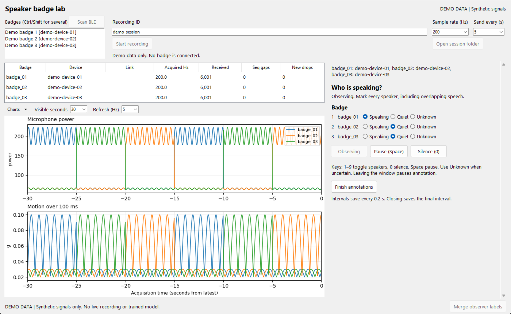
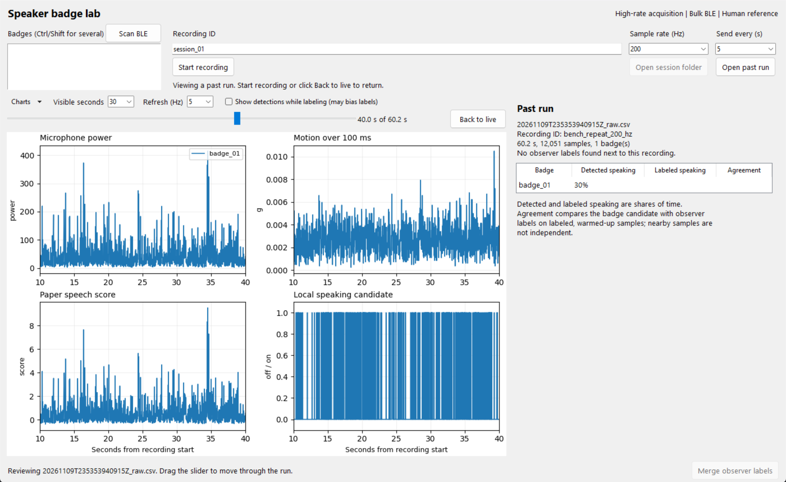

# Live speaker badge viewer

This native desktop viewer adapts the control and plotting approach from
`Nano33SenseRev2_SerialRealtime/realtime_viewer.py` to the new speaker firmware.
The old viewer is unchanged. This viewer uses BLE and the shared capture code;
it does not add a USB data stream to the speaker firmware.

## Run

From `TinyML_Speaker`:

```powershell
.\run.bat setup
.\run_viewer.bat
```

Matplotlib is the added plotting dependency. For a preview without a badge:

```powershell
.\run_viewer.bat --demo
```

The demo is explicitly labeled synthetic. It does not connect to BLE and cannot
validate sensor performance. The screenshots below use this mode.

## Record and monitor

1. Click **Scan BLE**, select the desired speaker badges, and verify their device
   identities against the physical wearers. Select up to nine badges (Ctrl or
   Shift for several). Windows Bluetooth adapters cap how many badges can be
   connected at once; the exact limit depends on the adapter.
2. Set an anonymous **Recording ID**, **Sample rate**, and **Send every** interval.
   These settings apply at recording start. Use the same ID for chunks of one
   session; use different IDs for independent sessions.
3. Click **Start recording**. Every received sample is saved into a new session
   folder under ignored `outputs/`. **Open session folder** locates the files.
   The **Link** column shows each badge as connected, reconnecting, or not
   connected. A badge that fails three connection attempts is skipped and named
   in the status line; the rest keep recording. A badge that drops reconnects on
   its own. Mark it Unknown in the observer panel while it is reconnecting.
4. Pick sensor charts from the **Charts** menu and adjust plot refresh or visible history as needed.
   Those controls affect drawing, not acquisition or CSV recording.
5. Click **Stop and save** to stop the badge, drain its buffer, and disconnect.
   Closing during a capture requests this same drain before the window exits.

The monitor shows measured rate from acquisition timestamps, received row counts,
sequence gaps, and new device drops relative to the first displayed row. The
plot history is bounded to 12,000 rows per badge and thinned to about 2,000 points
per trace. If the display queue falls behind, a footer message reports skipped
preview batches; CSV recording happens before plot delivery. Sensor traces from different
badges share their estimated UTC acquisition timeline, rather than aligning
unrelated device uptimes.

Above the table, a tile per badge shows its latest detection: green **Speaking**
or grey **Quiet**, with how old that reading is. The reading can be several
seconds old when sending in bulk; set **Send every** to 0 or 1 for a faster
indicator at the cost of more frequent BLE transfers. It is the badge's local
candidate, an estimate, not a reference annotation. `paper-rule` means no trained hybrid model is active. The optional
model-score chart has no valid score while the firmware reports -1.

## Make independent observer labels

The observer panel sits beside the live plots, so raw sensor data stays visible
while you annotate. The layout fits a normal window, so full screen is not required. Drag the divider to resize either side. While the panel is
open, the paper speech score, local candidate, and hybrid model charts and table
columns are hidden, so labels stay independent of the predictions they will be
used to evaluate. Click **Finish annotations** to show them again. To see the detection tiles and
prediction charts while labeling, tick **Show detections while labeling**. This
can bias your labels toward what the badge reports, which weakens them as a check
on that same badge, so leave it off for sessions you plan to use for evaluation.

Start observing explicitly, then mark speaking, quiet (not speaking), or unknown for each
wearer. Multiple speakers are supported. The keyboard shortcuts are the same as
the standalone panel: 1–9 toggle speakers, 0 marks observed silence, and Space
pauses. Leaving the window pauses annotation and keeps that time unknown.
Finishing annotations does not stop badge capture.

Labels are saved to `reference.csv` in the same session folder. Each change is
written immediately, and the current interval is checkpointed every 0.2 seconds.
A failed annotation save stops the observer panel without closing the live viewer.

After stopping the recording, click **Merge observer labels** to create
`training.csv`. The merge preserves unobserved time as unknown and excludes
200 ms around state boundaries. It refuses to overwrite an existing training
file. Train from multiple independently labeled sessions using the existing
`run.bat train` command. See [ground-truth timing and labeling guidance](GROUND_TRUTH.md).



## Review past runs

Click **Open past run** and pick a `*_raw.csv` file, either from a viewer session
folder or from the command-line receiver. Drag the slider to move through the
recording; **Visible seconds** sets the window width. If a `reference.csv` sits
in the same folder and contains Speaking or Quiet labels, an **Observer label**
chart appears and the side panel compares each badge's detections with those
labels. That comparison uses no boundary margin, so it can differ slightly from
`run.bat evaluate` on `training.csv`. Click **Back to live** or start a new
recording to leave review.



## Validation and limits

A single-board GUI check scanned, connected, drew all four default plots, and
saved 6,118 samples over 30.585 seconds of acquisition time at 200 Hz. The raw
CSV and plot receiver contained the same number of rows, with zero sequence
gaps and zero new device drops. Stop/drain and a merge with no observed labels
completed; all merged rows correctly remained unknown.

Synthetic UI tests cover the demo, embedded observer lifecycle, prediction hiding during annotation, sub-second checkpoints,
reference-save failure, empty connection-error reporting, cross-badge plot
alignment, detection tiles, and past-run review with and without labels. This does not establish multi-board reliability, speaker accuracy,
or independent human annotation quality. Matplotlib on the current Python 3.9
environment emits third-party Pyparsing deprecation warnings; the checks pass.
